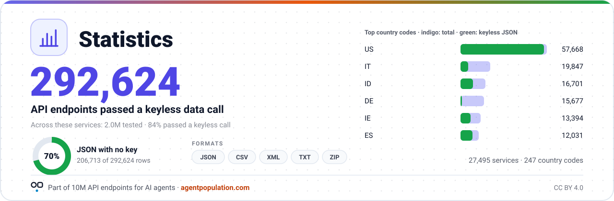
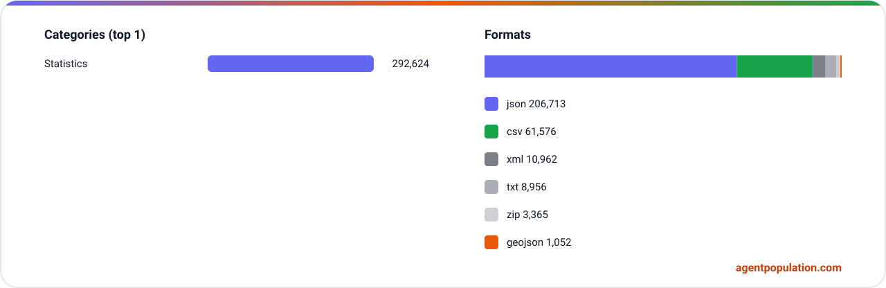

<p align="center"></p>

# 📊 Statistics and census API endpoints

**292,624 statistics and census API endpoints that answered a keyless GET with a data body. For agent and app builders.**

<p align="center"><a href="#files"></a> <a href="#columns-and-tags"></a> <a href="#whats-inside"></a> <a href="#whats-inside"></a> <a href="LICENSE"></a></p>

<p align="center"><a href="#whats-in-it-for-you">What's in it</a> · <a href="#for-ai-agents">For AI agents</a> · <a href="#quick-start">Quick start</a> · <a href="#test-it-yourself">Test it yourself</a> · <a href="#files">Files</a> · <a href="#licence-and-credit">Licence</a> · <a href="#part-of-10m-api-endpoints-for-ai-agents">More packs</a></p>

This repository holds a 1,000-row sample and the services list; the full list of 292,624 endpoints is one download from the [latest release](https://github.com/agentpopulation/290k-statistics-apis-for-agents/releases/latest).

**Endpoints for building an agent or app that answers with official statistics.** Country indicators (World Bank, UN SDG), Eurostat and national statistics tables, census and population layers, and statistics files as CSV and XML, as URLs that answered with no key on their test date.

Selection rule: rows where `category is "Statistics & Economy"`, less the rows that a leave-out rule drops (each counted under Known limits).

245,290 of these 292,624 rows match the focus rule (below); the others are in the pack by the selection rule only, and Known limits says what they are. 41,877 rows (14.3%) are map layers on ArcGIS Online, where anyone can publish.

## In plain words

**What is an API endpoint?** An API endpoint is one web address that a program can ask for data, for example the latest reading at one weather station. A single service, such as a national weather agency, can have thousands of endpoints: one per station, city or dataset. This pack counts endpoints, not separate services.

**What does "passed a data call" mean?** On the date shown in each row, AgentPopulation sent one plain request to that address, with no password or key, and got a non-empty data body back (JSON, CSV, XML or a file): not an error page and not an empty result. Some bodies describe a dataset rather than hold its values; see Known limits. It shows the address answered with data on that day. It is not a promise that it answers today, and licences and usage limits were not reviewed.

## What's in it for you

Four ways to use this pack. Each bucket gives a count, a filter you can apply to the CSV, one example that passed, and a list of recommended starting points with the rule that picked them. Buckets overlap; a row can fit more than one.

Examples, recommended lists and the preview are drawn from rows that match this pack's focus rule, so a row that the selection rule put in this pack but that is about something else is not shown as a starting point. Counts cover the whole bucket.

<details>
<summary>The focus rule</summary>

Focus rule: `NOT (subcategory matches /^ArcGIS feature layer/i AND NOT subcategory matches /^ArcGIS feature layer · (census|demographics|population)$/i) AND (title or subcategory matches /statist|census|censim|zensus|\bpopula|bevölker|einwohner|demogra|indicat|\bindice|\bindex|\bsdg\b|\bwdi\b|eurostat|statline|pxweb|singstat|\bowid\b|\bincome|employ|\blabou?r\b|\bgdp\b|\bprices?\b|inflation|\btrade\b|household|\bbirths?\b|\bdeaths?\b|mortality|fertility|\bmigra|poverty|\bwages?\b|earnings|enterprise|econom|\bsurvey|\brates?\b|per capita|statistik|statistiek|statistique|estad[ií]stic|estat[ií]stic|\btables?\b/i OR url matches /worldbank|unstats|eurostat|cbs\.nl|//[a-z0-9.]*stat\.|statistik|destatis|statbank|hagstof|hagstova|singstat|census\.gov|ourworldindata|worldpop|comtrade|unhcr|inps\.it|ksh\.hu|scb\.se|ssb\.no|psa\.gov\.ph|csu\.gov\.cz|statcan/i)`

</details>

### 🤖 Agent tools: Country indicators and statistics tables an agent can look up

**28,083** endpoints from 9 services · Wrap one URL pattern as a get_indicator tool: pass a country code and an indicator or table id, return the latest value with its period and unit.

Start with: `tags has agent-ready AND subcategory matches /World Bank WDI|UN SDG|^SDG (goal|indicators)|Eurostat dataset|CBS StatLine|SingStat|Singapore Department of Statistics|UN Comtrade|UNHCR/i`

Example: [World Bank WDI SP.POP.TOTL - Aruba](https://data360api.worldbank.org/data360/data?DATABASE_ID=WB_WDI&INDICATOR=WB_WDI_SP_POP_TOTL&REF_AREA=ABW&top=20) · World Bank Data360 / WDI · passed 2026-11-14

<details>
<summary>Recommended starting points: 8 services, picked by the stated criteria inside</summary>

**Recommended starting points.** Selected by stated criteria, not a ranking of quality: Services in this pack with the most endpoints that match this bucket and are tagged `agent-ready` (no key sent in the test call, JSON body, passed a data call). Ties go to the service with more country codes, then by name. Only services with at least one bucket row that matches the focus rule are listed, and the sample comes from those rows; the counts cover the whole bucket. The sample URL is the first row by URL sort after preferring, in this order: rows that match the bucket's sample preference when it has one, rows that return values rather than describe a dataset or a service (not ERDDAP /info/ pages, OGC GetCapabilities requests, bare OWS addresses, PxWeb tables, UN SDG series lists, Statistics Canada download pointers, WorldPop listings, GTFS validation reports, untitled rows or service root addresses), and agent-ready rows. Sample preference in this bucket: `NOT url contains "/GeoArea/" AND (NOT url contains "data360api.worldbank.org" OR url contains "SP_POP_TOTL")`. Services named "ArcGIS organization" hold map layers from many owners and are added only when fewer than 5 other services match.

| Service (host) | Endpoints in bucket | In pack | Country codes in bucket | Formats in bucket | Sample URL that passed |
|---|---:|---:|---|---|---|
| World Bank Data360 / WDI (data360api.worldbank.org) | 10,688 | 10,688 | 158 codes | json | [World Bank WDI SP.POP.TOTL - Aruba](https://data360api.worldbank.org/data360/data?DATABASE_ID=WB_WDI&INDICATOR=WB_WDI_SP_POP_TOTL&REF_AREA=ABW&top=20) (2026-11-14) |
| Eurostat dissemination API (ec.europa.eu) | 5,208 | 9,142 | EU | json | [Eurostat: Unit values at basic prices (…](https://ec.europa.eu/eurostat/api/dissemination/statistics/1.0/data/aact_uv01?lang=en&lastTimePeriod=1) (2026-11-14) |
| CBS StatLine (Netherlands) (opendata.cbs.nl) | 5,107 | 5,107 | NL | json | [CBS Netherlands: Redenen die een belang…](https://opendata.cbs.nl/ODataApi/odata/00370/TypedDataSet?$top=10&$format=json) (2026-11-14) |
| UN Statistics / SDG API (unstats.un.org) | 4,755 | 4,755 | 188 codes | json | [UN SDG: Global food loss index](https://unstats.un.org/sdgapi/v1/sdg/Series/Data?seriesCode=AG_FLS_INDEX&pageSize=10) (2026-11-14) |
| Singstat (tablebuilder.singstat.gov.sg) | 1,357 | 1,357 | SG | json | [SingStat: Chinese Resident Population b…](https://tablebuilder.singstat.gov.sg/api/table/tabledata/10118?limit=20) (2026-11-14) |
| comtradeapi.un.org | 437 | 437 | 112 codes | json | [UN Comtrade imports total 2022: Bulgaria](https://comtradeapi.un.org/public/v1/preview/C/A/HS?reporterCode=100&period=2022&partnerCode=0&cmdCode=TOTAL&flowCode=M) (2026-11-14) |
| Unhcr (api.unhcr.org) | 380 | 380 | 190 codes | json | [UNHCR: refugees & displaced people host…](https://api.unhcr.org/population/v1/population/?limit=100&coa=ABW&yearFrom=2015&coa_all=true) (2026-11-14) |
| data.gov.sg | 148 | 168 | SG | json | [data.gov.sg: Malay Resident Population …](https://data.gov.sg/api/action/datastore_search?resource_id=d_002ee7469e2b86728d07eea0a068e9b3&limit=5) (2026-11-14) |

</details>

### 📱 App features: Country charts and census, population and demographic maps

**15,603** endpoints from 2,665 services · Show one country or district on a chart or a map: OWID chart CSVs give a yearly series per country; census and demographic layers give values per tract or area.

3,159 of these are Our World in Data chart series for one country (CSV); the others are census, population and demographic map layers.

Start with: `subcategory contains "OWID chart data" OR subcategory matches /^ArcGIS feature layer · (census|demographics|population)$/i OR (format is geojson AND title matches /statist|census|censim|zensus|\bpopula|bevölker|einwohner|demogra|indicat|\bindice|\bindex|\bsdg\b|\bwdi\b|eurostat|statline|pxweb|singstat|\bowid\b|\bincome|employ|\blabou?r\b|\bgdp\b|\bprices?\b|inflation|\btrade\b|household|\bbirths?\b|\bdeaths?\b|mortality|fertility|\bmigra|poverty|\bwages?\b|earnings|enterprise|econom|\bsurvey|\brates?\b|per capita|statistik|statistiek|statistique|estad[ií]stic|estat[ií]stic|\btables?\b/i)`

Example: [Our World in Data: population density - Aruba](https://ourworldindata.org/grapher/population-density.csv?v=1&csvType=filtered&useColumnShortNames=true&country=~ABW) · Our World in Data · passed 2026-11-14

<details>
<summary>Recommended starting points: 8 services, picked by the stated criteria inside</summary>

**Recommended starting points.** Selected by stated criteria, not a ranking of quality: Services in this pack with the most endpoints that match this bucket and passed a data call. Ties go to the service with more country codes, then by name. Only services with at least one bucket row that matches the focus rule are listed, and the sample comes from those rows; the counts cover the whole bucket. The sample URL is the first row by URL sort after preferring, in this order: rows that match the bucket's sample preference when it has one, rows that return values rather than describe a dataset or a service (not ERDDAP /info/ pages, OGC GetCapabilities requests, bare OWS addresses, PxWeb tables, UN SDG series lists, Statistics Canada download pointers, WorldPop listings, GTFS validation reports, untitled rows or service root addresses), and agent-ready rows. Sample preference in this bucket: `title matches /population|census|demograph/i`. Services named "ArcGIS organization" hold map layers from many owners and are added only when fewer than 5 other services match.

| Service (host) | Endpoints in bucket | In pack | Country codes in bucket | Formats in bucket | Sample URL that passed |
|---|---:|---:|---|---|---|
| Our World in Data (ourworldindata.org) | 3,159 | 3,159 | 190 codes | csv | [Our World in Data: population density -…](https://ourworldindata.org/grapher/population-density.csv?v=1&csvType=filtered&useColumnShortNames=true&country=~ABW) (2026-11-14) |
| GIS Online at UCLA (ArcGIS Online) (services7.arcgis.com) | 404 | 454 | CN, GB, US | json | [101123\_census\_acs\_join](https://services7.arcgis.com/2hYXmwteFLemN5bW/arcgis/rest/services/101123_census_acs_join/FeatureServer/0/query?where=1%3D1&outFields=*&returnGeometry=false&resultRecordCount=5&f=json) (2026-11-14) |
| University of Texas at Arlington (ArcGIS Online) (services5.arcgis.com) | 183 | 212 | US | json | [Beaumont Key Demographics RC](https://services5.arcgis.com/z5pCt1Uf7GwSRRTu/arcgis/rest/services/Beaumont%20Key%20Demographics%20RC/FeatureServer/0/query?where=1%3D1&outFields=*&returnGeometry=false&resultRecordCount=5&f=json) (2026-11-14) |
| California State University Long Beach - Geography (ArcGIS Online) (services3.arcgis.com) | 147 | 195 | US | json | [2010\_Census](https://services3.arcgis.com/vq5vGR4r1YX7ueLg/arcgis/rest/services/2010_Census/FeatureServer/0/query?where=1%3D1&outFields=*&returnGeometry=false&resultRecordCount=5&f=json) (2026-11-14) |
| Farmingdale State College (ArcGIS Online) (services7.arcgis.com) | 83 | 595 | US | json | [ACS\_Population\_Detroit1](https://services7.arcgis.com/6o0M9YyJcHjZF5MP/arcgis/rest/services/ACS_Population_Detroit1/FeatureServer/0/query?where=1%3D1&outFields=*&returnGeometry=false&resultRecordCount=5&f=json) (2026-11-14) |
| Heritage High School (ArcGIS Online) (services4.arcgis.com) | 80 | 97 | US | json | [2000 Loudoun Population](https://services4.arcgis.com/9KQoqeF3ngzokvt0/arcgis/rest/services/2000%20Loudoun%20Population/FeatureServer/0/query?where=1%3D1&outFields=*&returnGeometry=false&resultRecordCount=5&f=json) (2026-11-14) |
| University of Calgary (ArcGIS Online) (services2.arcgis.com) | 71 | 79 | 5 codes | json | [2016 Calgary Community Census](https://services2.arcgis.com/XSv3KNGfmrd1txPN/arcgis/rest/services/2016_Calgary_Community_Census/FeatureServer/0/query?where=1%3D1&outFields=*&returnGeometry=false&resultRecordCount=5&f=json) (2026-11-14) |
| University of Minnesota (ArcGIS Online) (services.arcgis.com) | 69 | 223 | US | json | [1990s\_census\_tracts\_processed](https://services.arcgis.com/8df8p0NlLFEShl0r/arcgis/rest/services/1990s_census_tracts_processed/FeatureServer/0/query?where=1%3D1&outFields=*&returnGeometry=false&resultRecordCount=5&f=json) (2026-11-14) |

</details>

### 🧠 Grounding and data pipelines: Statistics tables as CSV, XML and SDMX files for scheduled loads

**84,859** endpoints from 1,084 services · Load statistics tables on a schedule into your own store, keeping the table id and period, so answers cite a dated official figure.

Start with: `format in (csv, xml, txt, zip)`

Example: [Luas Panen Cabe Rawit - Laren - Periode Desember …](https://data.lamongankab.go.id/dataset/001038f8-5427-4956-9f14-a233c918f175/resource/6f67ea4a-0a0e-47b4-bb96-bfb9a603e399/download/data_statistik.csv) · Portal Data Lamongan · passed 2026-11-15

<details>
<summary>Recommended starting points: 8 services, picked by the stated criteria inside</summary>

**Recommended starting points.** Selected by stated criteria, not a ranking of quality: Services in this pack with the most endpoints that match this bucket and passed a data call. Ties go to the service with more country codes, then by name. Only services with at least one bucket row that matches the focus rule are listed, and the sample comes from those rows; the counts cover the whole bucket. The sample URL is the first row by URL sort after preferring, in this order: rows that match the bucket's sample preference when it has one, rows that return values rather than describe a dataset or a service (not ERDDAP /info/ pages, OGC GetCapabilities requests, bare OWS addresses, PxWeb tables, UN SDG series lists, Statistics Canada download pointers, WorldPop listings, GTFS validation reports, untitled rows or service root addresses), and agent-ready rows. Sample preference in this bucket: `format is csv AND NOT url contains "compressed=true"`. Services named "ArcGIS organization" hold map layers from many owners and are added only when fewer than 5 other services match.

| Service (host) | Endpoints in bucket | In pack | Country codes in bucket | Formats in bucket | Sample URL that passed |
|---|---:|---:|---|---|---|
| Portal Data Lamongan (data.lamongankab.go.id) | 8,251 | 16,501 | ID | csv | [Luas Panen Cabe Rawit - Laren - Periode…](https://data.lamongankab.go.id/dataset/001038f8-5427-4956-9f14-a233c918f175/resource/6f67ea4a-0a0e-47b4-bb96-bfb9a603e399/download/data_statistik.csv) (2026-11-15) |
| Ireland Open Data Portal (ws.cso.ie) | 5,931 | 12,294 | IE | csv | [A0101 - 1996 Population and Percentage …](https://ws.cso.ie/public/api.restful/PxStat.Data.Cube_API.ReadDataset/A0101/CSV/1.0/en) (2026-11-14) |
| Eurostat dissemination API (ec.europa.eu) | 3,934 | 9,142 | EU | csv, txt, xml | [Eurostat Comext: Total production](https://ec.europa.eu/eurostat/api/comext/dissemination/sdmx/2.1/data/DS-059359?lastNObservations=1&detail=dataonly) (2026-11-14) |
| region.statistik-nord.de | 3,211 | 3,211 | DE | txt, csv | [Bevölkerungsstand nach Altersgruppen in…](https://region.statistik-nord.de/detail_timelineexport/13/1102/5/1/345/368/) (2026-11-15) |
| Our World in Data (ourworldindata.org) | 3,159 | 3,159 | 190 codes | csv | [Our World in Data: cereal yield - Aruba](https://ourworldindata.org/grapher/cereal-yield.csv?v=1&csvType=filtered&useColumnShortNames=true&country=~ABW) (2026-11-14) |
| Datos Abiertos de Canarias (datos.canarias.es) | 2,846 | 7,747 | ES | xml, csv | [Indicadores laborales. Barrios de Canar…](https://datos.canarias.es/api/estadisticas/geographical-resources/epareg/ows?service=WFS&version=1.1.0&request=GetFeature&typeName=Barrios-2013&outputFormat=csv) (2026-11-15) |
| INPS open data (Italy) (opendata.inps.it) | 2,823 | 4,234 | IT | csv, xml, txt | [Pensions in force for Breakdowns, Age c…](https://opendata.inps.it/download/dataset/dfb_st_compl_pensioni_vigenti_02_inps_1_0/filesystem/Pensioni%20vigenti%20per%20Ripartizioni%2C%20Classe%20d%27età%2C%20Classe%20di%20importo%20e%20Sesso.csv) (2026-11-14) |
| Destatis GENESIS (Germany) (genesis.destatis.de) | 2,061 | 2,061 | DE | xml, txt | [Hours worked per week by workers from m…](https://genesis.destatis.de/genesisWS/downloads/00/tables/12211-0006_00.csv) (2026-11-14) |

</details>

### 🧪 Evals and testing: Indicator series, tables and files to test a statistics tool

**116,536** endpoints from 200 services · Run your statistics tool against a fixed set of URLs across formats (JSON-stat, OData, CSV, XML); check that period, value and unit parse, and keep last_tested as the baseline for your own re-tests.

Start with: `url matches /worldbank|unstats|eurostat|cbs\.nl|//[a-z0-9.]*stat\.|statistik|destatis|statbank|hagstof|hagstova|singstat|census\.gov|ourworldindata|worldpop|comtrade|unhcr|inps\.it|ksh\.hu|scb\.se|ssb\.no|psa\.gov\.ph|csu\.gov\.cz|statcan/i`

Example: [Jumlah Populasi Hewan Ternak Besar Kabupaten Lamo…](https://data.lamongankab.go.id/dataset/08c3611e-2db5-4f33-8623-420440fbee99/resource/e11522ed-1d61-498f-a90e-bf10038eed13/download/data_statistik.json) · Portal Data Lamongan · passed 2026-11-15

<details>
<summary>Recommended starting points: 8 services, picked by the stated criteria inside</summary>

**Recommended starting points.** Selected by stated criteria, not a ranking of quality: Services in this pack that returned the most different formats, then the most endpoints that passed a data call, then by name: a mix of response shapes to test parsers and tool calls. Only services with at least one bucket row that matches the focus rule are listed, and the sample comes from those rows; the counts cover the whole bucket. The sample URL is the first row by URL sort after preferring, in this order: rows that match the bucket's sample preference when it has one, rows that return values rather than describe a dataset or a service (not ERDDAP /info/ pages, OGC GetCapabilities requests, bare OWS addresses, PxWeb tables, UN SDG series lists, Statistics Canada download pointers, WorldPop listings, GTFS validation reports, untitled rows or service root addresses), and agent-ready rows. Sample preference in this bucket: `title matches /statist|census|censim|zensus|\bpopula|bevölker|einwohner|demogra|indicat|\bindice|\bindex|\bsdg\b|\bwdi\b|eurostat|statline|pxweb|singstat|\bowid\b|\bincome|employ|\blabou?r\b|\bgdp\b|\bprices?\b|inflation|\btrade\b|household|\bbirths?\b|\bdeaths?\b|mortality|fertility|\bmigra|poverty|\bwages?\b|earnings|enterprise|econom|\bsurvey|\brates?\b|per capita|statistik|statistiek|statistique|estad[ií]stic|estat[ií]stic|\btables?\b/i`. Services named "ArcGIS organization" hold map layers from many owners and are added only when fewer than 5 other services match.

| Service (host) | Endpoints in bucket | In pack | Country codes in bucket | Formats in bucket | Sample URL that passed |
|---|---:|---:|---|---|---|
| opendata.duesseldorf.de | 20 | 417 | DE | csv | [Police crime statistics 2020](https://opendata.duesseldorf.de/sites/default/files/Polizeiliche%20Kriminalstatistik%202020.csv) (2026-11-14) |
| Портал відкритих даних (data.gov.ua) | 1 | 1,091 | UA | csv | [Адміністративні дані в значенні Закону …](https://data.gov.ua/dataset/f6a9109a-a48a-4b08-bb88-5c6cdcb44f53/resource/474f080f-3ba4-4546-a1ef-ab5aa42b7f49/download/administrativni-dani-v-znacheni-zakonu-ukrayini-pro-derzhavnu-statistiku.csv) (2026-11-15) |
| Eurostat dissemination API (ec.europa.eu) | 9,141 | 9,142 | EU | json, csv, txt, xml | [Eurostat: Unit values at basic prices (…](https://ec.europa.eu/eurostat/api/dissemination/statistics/1.0/data/aact_uv01?lang=en&lastTimePeriod=1) (2026-11-14) |
| INPS open data (Italy) (opendata.inps.it) | 4,234 | 4,234 | IT | csv, json, xml, txt | [Employees by Divisions, Qualification, …](https://opendata.inps.it/download/dataset/dfb_st_dip_ateco_ter_2014_01_inps_1_0/filesystem/Lavoratori%20dipendenti%20per%20Ripartizioni%2C%20Qualifica%2C%20Presenza%20tempo%20parziale%20e%20Sezioni%20ateco%202007%20-%202014.json) (2026-11-14) |
| www.offenesdatenportal.de | 100 | 317 | DE | csv, xml, zip | [Baustatistik (Stadt Moers) - Baustatist…](https://www.offenesdatenportal.de/dataset/026b6bd5-e078-4f77-b15b-8063e7b740ea/resource/155688f5-e2bc-4b5d-8201-76cd49849349/download/baustatistik2012.csv) (2026-11-15) |
| Latvijas Atvērto datu portāls (data.gov.lv) | 83 | 776 | LV | csv, json | [data.gov.lv: Visit statistics of the La…](https://data.gov.lv/dati/dataset/55f359e8-11ab-435f-b6fa-aae05b3ea334/resource/d7c85c14-59de-4e88-a6c8-86c9cc73c23c/download/data_gov_lv_statistika_lapu_skatijumi_2017-06-01_2018-06-01_metadata.json) (2026-11-15) |
| www.data.gv.at | 11 | 308 | AT | csv, zip | [Meeting statistics Municipality of Enge…](https://www.data.gv.at/katalog/dataset/4a8f1f1a-4ac5-4c35-a528-62fe4a0c7379/resource/1fe90a9c-3a1e-4255-a817-e6c53facc7ac/download/anzahl-der-sitzungen_sitzungsstatistik-2014-2017.xlsx) (2026-11-14) |
| Greece National Data Portal (data.gov.gr) | 10 | 241 | GR | csv, json | [Poängstatistik för EPAL-kandidater i Pa…](https://data.gov.gr/dataset/0963c199-addc-4fc3-b56f-39520fa14796/resource/ac85873b-ff81-474c-a2f5-a106b322b432/download/21-statistika-klimakas-morionepalpan.2017.csv) (2026-11-14) |

</details>

The same lists are in [recommended.json](recommended.json), ready for an agent to load.

## Questions an agent can answer with this pack

- What total population does the World Bank report for a country? Try [World Bank WDI SP.POP.TOTL - Aruba](https://data360api.worldbank.org/data360/data?DATABASE_ID=WB_WDI&INDICATOR=WB_WDI_SP_POP_TOTL&REF_AREA=ABW&top=20) (World Bank Data360 / WDI, passed 2026-11-14).
- What does one UN SDG indicator series show for a given country? Try [UN SDG series AG\_LND\_FRST: Bulgaria](https://unstats.un.org/sdgapi/v1/sdg/Series/Data?seriesCode=AG_LND_FRST&areaCode=100&pageSize=200) (UN Statistics / SDG API, passed 2026-11-14).
- What is the population of Denmark at the start of the latest quarter? Try [Statistics Denmark: Population at the first day o…](https://api.statbank.dk/v1/data/FOLK1A/CSV?lang=en) (Statbank, passed 2026-11-14).
- What do the first rows of a Statistics Netherlands (CBS) table show? Try [CBS Netherlands: Redenen die een belangrijke rol …](https://opendata.cbs.nl/ODataApi/odata/00370/TypedDataSet?$top=10&$format=json) (CBS StatLine (Netherlands), passed 2026-11-14).

## What "passed a data call" means

> [!NOTE]
> On the date in `last_tested` (IST), one GET to the URL, sent with no key, returned HTTP 2xx and a non-empty data body. HTML pages and empty results did not pass. The `format` column records what came back. This is a test result for that date, not a promise that the URL answers today. Licences, terms, rate limits, accuracy and freshness were not reviewed. Endpoints are URLs, not separate APIs; many share one service. This pack was tested 14–15 Nov 2026; snapshot 15 Nov 2026.

## For AI agents

Start from keyless JSON endpoints (`agent-ready`). The code below loads `recommended.json` and calls the first recommended service in the Agent tools bucket, with a timeout (`node examples/agent-start.mjs --recommended`). With no argument, `node examples/agent-start.mjs` calls the most recently tested agent-ready row of the sample; pass a `.csv` or `.csv.gz` path to use that file instead. See [examples/agent-start.mjs](examples/agent-start.mjs).

```js
// Node 18+. Loads recommended.json (the local copy, or the raw file on GitHub) and calls one keyless JSON endpoint.
import fs from 'node:fs';

const RAW = 'https://raw.githubusercontent.com/agentpopulation/290k-statistics-apis-for-agents/main/recommended.json';
const rec = fs.existsSync('recommended.json')
  ? JSON.parse(fs.readFileSync('recommended.json', 'utf8'))
  : await (await fetch(RAW)).json();

const pick = rec.buckets.find((b) => b.id === 'agent').services[0];
try {
  const res = await fetch(pick.sample_url, {
    headers: { 'User-Agent': 'agent-example/1.0' },
    signal: AbortSignal.timeout(15000),
  });
  console.log(pick.service, res.status, res.headers.get('content-type'));
  console.log((await res.text()).slice(0, 300));
} catch (err) {
  console.log(`did not answer now; last passed ${pick.sample_last_tested} (${err.message})`);
}
```

How an agent picks an endpoint:

1. Filter to `agent-ready` and your country or topic.
2. Prefer the newest `last_tested` and the larger services.
3. Call with a timeout and check the body before you use it.

## Quick start

The examples run against the sample in `data/` out of the box (1,000 rows). Each takes an optional path to a `.csv` or `.csv.gz` file instead.

```bash
git clone https://github.com/agentpopulation/290k-statistics-apis-for-agents.git
cd 290k-statistics-apis-for-agents
python examples/quickstart.py
node examples/quickstart.mjs
node examples/agent-start.mjs
```

Full list: download `Statistics_API_Endpoints_AgentPopulation_Snapshot_2026-11-15.csv.gz` (292,624 rows, 12.6 MB) from [releases/latest](https://github.com/agentpopulation/290k-statistics-apis-for-agents/releases/latest), then gunzip it and pass its path. The scripts also read the `.csv.gz` as it is.

```bash
gunzip Statistics_API_Endpoints_AgentPopulation_Snapshot_2026-11-15.csv.gz
python examples/quickstart.py Statistics_API_Endpoints_AgentPopulation_Snapshot_2026-11-15.csv
node examples/quickstart.mjs Statistics_API_Endpoints_AgentPopulation_Snapshot_2026-11-15.csv
```

### curl

Quote the URL: some contain commas.

```bash
curl -sL "https://raw.githubusercontent.com/agentpopulation/290k-statistics-apis-for-agents/main/data/Statistics_API_Endpoints_AgentPopulation_Sample.csv" | head -n 4
curl -s --max-time 15 "https://data360api.worldbank.org/data360/data?DATABASE_ID=WB_WDI&INDICATOR=WB_WDI_SP_POP_TOTL&REF_AREA=ABW&top=20" | head -c 600
```

### Python

Standard library only: [examples/quickstart.py](examples/quickstart.py) reads the sample, or the path you pass, keeps agent-ready rows and calls the most recently tested one.

<details>
<summary>The code</summary>

```python
# Python 3, standard library only. Run from a clone of this repository:
#   python examples/quickstart.py [path]
# With no path it reads the sample in data/. Pass the full list from the latest release (.csv or .csv.gz) instead.
# Keeps agent-ready rows and calls the most recently tested one.
import csv
import gzip
import os
import re
import sys
import urllib.request

HERE = os.path.dirname(os.path.abspath(__file__))
path = sys.argv[1] if len(sys.argv) > 1 else os.path.join(HERE, "..", "data", "Statistics_API_Endpoints_AgentPopulation_Sample.csv")
opener = gzip.open if path.endswith(".gz") else open
with opener(path, "rt", newline="", encoding="utf-8") as f:
    rows = list(csv.DictReader(f))

agent = [r for r in rows if "agent-ready" in r["tags"].split("|")]
# Newest test date first; URLs that describe a dataset or a service rather than return values go last.
DESCRIBES = re.compile(r"/erddap/info/|action-report\.json$|[?&]request=getcapabilities|/GeoArea/[^/?]+/List|getFullTableDownloadCSV|hub\.worldpop\.org", re.I)
agent.sort(key=lambda r: r["last_tested"], reverse=True)
agent.sort(key=lambda r: 1 if DESCRIBES.search(r["url"]) else 0)
print(len(rows), "rows,", len(agent), "agent-ready")
if not agent:
    sys.exit(0)

row = agent[0]
req = urllib.request.Request(row["url"], headers={"User-Agent": "agent-example/1.0"})
try:
    with urllib.request.urlopen(req, timeout=15) as res:
        body = res.read(1_000_000).decode("utf-8", "replace")
        print(res.status, res.headers.get("Content-Type"))
        print(body[:300])
except Exception as err:
    print(f"did not answer now; last passed {row['last_tested']} ({err})")
```

</details>

### JavaScript

Reads the sample as JSON because the CSV has quoted commas.

<details>
<summary>The code</summary>

```js
// Node 18+. Reads the sample as JSON (the CSV has quoted commas), local file first.
import fs from 'node:fs';

const FILE = 'data/Statistics_API_Endpoints_AgentPopulation_Sample.json';
const rows = fs.existsSync(FILE)
  ? JSON.parse(fs.readFileSync(FILE, 'utf8'))
  : await (await fetch('https://raw.githubusercontent.com/agentpopulation/290k-statistics-apis-for-agents/main/data/Statistics_API_Endpoints_AgentPopulation_Sample.json')).json();

const row = rows.find((r) => r.tags.includes('agent-ready'));
const res = await fetch(row.url, { headers: { 'User-Agent': 'agent-example/1.0' }, signal: AbortSignal.timeout(15000) });
console.log(res.status, (await res.text()).slice(0, 300));
```

</details>

### Agent tools

[examples/agent-tools.json](examples/agent-tools.json) holds two tool definitions in the shape most tool-calling APIs accept (name, description, JSON Schema); rename `parameters` if yours uses another key. [examples/quickstart.mjs](examples/quickstart.mjs) implements them:

- `find_endpoints` searches the agent-ready rows of the list by words, country code (their format is json). When you load the tools of more than one pack, prefix the names (for example `statistics_find_endpoints`) so they do not clash.
- `fetch_endpoint` calls one URL, **refuses any URL that is not in the list** and does not follow redirects. The allowlist is built from the CSV, so a URL injected into a prompt is refused.

The same two tools can sit behind an MCP server.

## Test it yourself

Re-test endpoints from the sample with the same rule: HTTP 2xx and a non-empty body that is not an HTML page. Node 18+, no packages.

```bash
node tools/test-endpoints.mjs
```

It tests the first 50 URLs and prints one line: tested, passed, did not pass. Options: a `.csv` or `.csv.gz` path (the full list from the release), `--limit 50`, `--timeout-ms 10000`, `--out results.csv`. The results file holds `url`, `status`, `passed`, `content_type`, `ms` and `checked_at`; a status of `timeout` or `error:<code>` means no HTTP answer came back. It is polite: GET only, no key sent, at most 4 requests in flight, one at a time per listed host, at least 1 second between requests to one listed host, and reading stops once 256 kB of a body is kept. Redirects are followed and may lead to another host. `results.csv` is in `.gitignore`.

## Preview

One row from each of the five largest services among rows that match the focus rule, services with rows that return values first, and before them services with a row where `NOT url contains "/GeoArea/" AND NOT subcategory matches /PxWeb/i AND NOT host in (pxweb.stat.si, api.scb.se, data.ssb.no, andmed.stat.ee, openstat.psa.gov.ph)`.

| Title | Service | Country | Format | Tested | Link |
|---|---|---|---|---|---|
| Jumlah Aparatur Pemerintah Desa Tracal Kecamatan Karanggene… | Portal Data Lamongan | ID | json | 2026-11-15 | [data.lamongankab.go.id](https://data.lamongankab.go.id/dataset/0007fd8c-b341-4362-a10d-3b670c3bfc46/resource/c748c193-151f-4eba-ab14-b3220fba66df/download/data_statistik.json) |
| A0101 - 1996 Population and Percentage Change 1991 and 1996… | Ireland Open Data Portal | IE | json | 2026-11-15 | [ws.cso.ie](https://ws.cso.ie/public/api.restful/PxStat.Data.Cube_API.ReadDataset/A0101/JSON-stat/1.0/en) |
| World Bank WDI AG.CON.FERT.ZS - Aruba | World Bank Data360 / WDI | AW | json | 2026-11-14 | [data360api.worldbank.org](https://data360api.worldbank.org/data360/data?DATABASE_ID=WB_WDI&INDICATOR=WB_WDI_AG_CON_FERT_ZS&REF_AREA=ABW&top=20) |
| Eurostat: Unit values at basic prices (1980-2018) | Eurostat dissemination API | EU | json | 2026-11-14 | [ec.europa.eu](https://ec.europa.eu/eurostat/api/dissemination/statistics/1.0/data/aact_uv01?lang=en&lastTimePeriod=1) |
| Indicadores laborales. Barrios de Canarias. 2017 - Indicado… | Datos Abiertos de Canarias | ES | json | 2026-11-15 | [datos.canarias.es](https://datos.canarias.es/api/estadisticas/geographical-resources/epareg/ows?service=WFS&version=1.1.0&request=GetFeature&typeName=Barrios-2017&outputFormat=application/json) |

Browse the 1,000-row sample: [Sample CSV](data/Statistics_API_Endpoints_AgentPopulation_Sample.csv) · [Sample JSON](data/Statistics_API_Endpoints_AgentPopulation_Sample.json).

## What's inside

<p align="center"></p>

<details>
<summary>Country codes: 247</summary>

| Code | Country | Endpoints | |
|---|---|---:|---|
| US | United States | 57,668 | `████████████████████` |
| IT | Italy | 19,847 | `██████▉` |
| ID | Indonesia | 16,701 | `█████▊` |
| DE | Germany | 15,677 | `█████▍` |
| IE | Ireland | 13,394 | `████▋` |
| ES | Spain | 12,031 | `████▏` |
| EU | European Union | 9,918 | `███▌` |
| SI | Slovenia | 7,681 | `██▋` |
| GB | United Kingdom | 7,407 | `██▋` |
| NO | Norway | 6,668 | `██▍` |
| | other 237 codes | 115,074 | |
| | global or unknown | 10,558 | `███▋` |

</details>

<details>
<summary>Categories: top 1</summary>

| Category | Endpoints | |
|---|---:|---|
| Statistics & Economy | 292,624 | `████████████████████` |

</details>

Formats: json 206,713 · csv 61,576 · xml 10,962 · txt 8,956 · zip 3,365 · geojson 1,052

<details>
<summary>Largest services: top 25 of 27,495</summary>

| Service | Host | Endpoints | Keyless JSON | |
|---|---|---:|---:|---|
| Portal Data Lamongan | data.lamongankab.go.id | 16,501 | 8,250 | `████████████████████` |
| Ireland Open Data Portal | ws.cso.ie | 12,294 | 6,363 | `██████████████▉` |
| World Bank Data360 / WDI | data360api.worldbank.org | 10,688 | 10,688 | `█████████████` |
| Eurostat dissemination API | ec.europa.eu | 9,142 | 5,208 | `███████████▏` |
| Datos Abiertos de Canarias | datos.canarias.es | 7,747 | 4,901 | `█████████▍` |
| Statistical Office of Slovenia PxWeb | pxweb.stat.si | 7,412 | 7,412 | `█████████` |
| Statistics Norway PxWeb | data.ssb.no | 6,612 | 6,612 | `████████` |
| CBS StatLine (Netherlands) | opendata.cbs.nl | 5,107 | 5,107 | `██████▎` |
| UN Statistics / SDG API | unstats.un.org | 4,755 | 4,755 | `█████▊` |
| INPS open data (Italy) | opendata.inps.it | 4,234 | 1,411 | `█████▏` |
| Hagstofa | px.hagstofa.is | 3,488 | 3,488 | `████▎` |
| Worldpop | hub.worldpop.org | 3,484 | 3,484 | `████▎` |
| Stat | pxdata.stat.fi | 3,386 | 3,386 | `████▏` |
| Statistics Canada WDS | www150.statcan.gc.ca | 3,380 | 3,380 | `████▏` |
| Statistics Sweden (SCB) PxWeb | api.scb.se | 3,270 | 3,270 | `████` |
| Stat | andmed.stat.ee | 3,222 | 3,222 | `███▉` |
| region.statistik-nord.de | region.statistik-nord.de | 3,211 | 0 | `███▉` |
| Our World in Data | ourworldindata.org | 3,159 | 0 | `███▉` |
| tabular-api.data.gouv.fr | tabular-api.data.gouv.fr | 2,514 | 2,514 | `███` |
| Psa | openstat.psa.gov.ph | 2,097 | 2,097 | `██▌` |
| Destatis GENESIS (Germany) | genesis.destatis.de | 2,061 | 0 | `██▌` |
| Stat | opendata.stat.gov.rs | 1,929 | 942 | `██▍` |
| OpenData Milano | dati.comune.milano.it | 1,826 | 892 | `██▎` |
| Catálogo de datos abiertos del IBESTAT | ibestat.es | 1,600 | 1,557 | `██` |
| Lombardia | www.dati.lombardia.it | 1,582 | 784 | `█▉` |

</details>

<details>
<summary>Rows per test date: 14–15 Nov 2026</summary>

| Date (IST) | Endpoints | |
|---|---:|---|
| 2026-11-15 | 174,571 | `████████████████████` |
| 2026-11-14 | 118,053 | `█████████████▌` |

</details>

## Files

| File | Rows | Size | Use |
|---|---:|---:|---|
| [data/Statistics_API_Services_AgentPopulation.csv](data/Statistics_API_Services_AgentPopulation.csv) | 27,495 | 1.2 MB | One row per service with its endpoint count in this pack |
| [data/Statistics_API_Endpoints_AgentPopulation_Sample.csv](data/Statistics_API_Endpoints_AgentPopulation_Sample.csv) | 1,000 | 322.6 kB | The sample: focus-rule rows first, each service in proportion to its share; ArcGIS Online layers count as one service |
| [data/Statistics_API_Endpoints_AgentPopulation_Sample.json](data/Statistics_API_Endpoints_AgentPopulation_Sample.json) | 1,000 | 514.8 kB | The same rows as JSON, tags as an array |
| [Statistics_API_Endpoints_AgentPopulation_Snapshot_2026-11-15.csv.gz](https://github.com/agentpopulation/290k-statistics-apis-for-agents/releases/latest) | 292,624 | 12.6 MB | The full list, gzipped CSV: a download from the latest release, checked by `SHA256SUMS.txt` |
| [tools/test-endpoints.mjs](tools/test-endpoints.mjs) | | | Re-tests endpoints from the sample or the full list |

Sample size: 1,000 rows, which is 1,000 or one third of the pack rounded down, whichever is smaller. Rows that match the focus rule come first. Each service gets rows in proportion to its share of those rows, at least one for the largest services and at most 50% of the sample while other services have rows; ArcGIS Online layers count as one service, whatever their organisation. Within a service, agent-ready rows, rows that return values and the newest test dates come first, and rows are written in turn across services. Service root addresses are placed at the end of the sample.

Full list: download `Statistics_API_Endpoints_AgentPopulation_Snapshot_2026-11-15.csv.gz` (292,624 rows, 12.6 MB) from [releases/latest](https://github.com/agentpopulation/290k-statistics-apis-for-agents/releases/latest), then gunzip it and pass its path. The scripts also read the `.csv.gz` as it is.

Excel users: Data > From Text/CSV, UTF-8. Files are UTF-8 without a byte-order mark and comma-separated.

## Columns and tags

<details>
<summary>Columns, types and tags</summary>

| Column | Type | Example | Meaning |
|---|---|---|---|
| url | string | [https://data.lamongankab.go.id/dataset/…](https://data.lamongankab.go.id/dataset/0007fd8c-b341-4362-a10d-3b670c3bfc46/resource/c748c193-151f-4eba-ab14-b3220fba66df/download/data_statistik.json) | The address that was tested |
| title | string | Jumlah Aparatur Pemerintah Desa Tracal … | Station, dataset or feed name |
| service | string | Portal Data Lamongan | The service the endpoint belongs to; joins to the services file together with host |
| host | string | data.lamongankab.go.id | Host name of the address |
| country | string | ID | ISO 3166-1 alpha-2 code, or EU; empty when global or unknown |
| category | string | Statistics & Economy | Category of the endpoint |
| subcategory | string |  | Left empty from the 15 Nov 2026 snapshot; kept so the columns stay the same |
| format | string | json | What the test call returned: json, csv, geojson, xml, gtfs, zip, txt and so on |
| tags | string | `statistics\|open-data\|no-key\|json\|agent-…` | Tags separated by \| |
| last_tested | date | 2026-11-15 | Date of the test call, YYYY-MM-DD (IST) |

| Tag | Rows | Meaning |
|---|---:|---|
| no-key | 292,624 | No key was sent in the test call |
| statistics | 292,624 | Topic tag |
| agent-ready | 206,713 | No key sent, JSON body, passed a data call on last_tested |
| json | 206,713 | Format of the body |
| open-data | 93,435 | Topic tag |
| csv | 61,576 | Format of the body |
| maps | 47,647 | Topic tag |
| government | 34,071 | Topic tag |
| economy | 18,898 | Topic tag |
| finance | 16,218 | Topic tag |
| xml | 10,962 | Format of the body |
| weather | 1,193 | Topic tag |
| science | 1,098 | Topic tag |
| geojson | 1,052 | Format of the body |
| aviation | 635 | Topic tag |
| forecast | 612 | Topic tag |
| health | 611 | Topic tag |
| transit | 569 | Topic tag |
| maritime | 407 | Topic tag |
| hazards | 120 | Topic tag |
| energy | 106 | Topic tag |
| environment | 104 | Topic tag |
| climate | 85 | Topic tag |
| oceans | 82 | Topic tag |
| rivers | 76 | Topic tag |
| traffic | 27 | Topic tag |
| geocoding | 22 | Topic tag |
| air-quality | 20 | Topic tag |
| ai-ml | 16 | Topic tag |
| earthquakes | 14 | Topic tag |
| floods | 13 | Topic tag |
| groundwater | 6 | Topic tag |
| speech | 5 | Topic tag |
| elevation | 2 | Topic tag |
| tides | 2 | Topic tag |
| wildfire | 2 | Topic tag |
| embeddings | 1 | Topic tag |
| mcp-server | 1 | Topic tag |
| tsunami | 1 | Topic tag |

A machine-readable copy of this dictionary is in [datapackage.json](datapackage.json).

</details>

## Known limits

- 19.7% of rows carry country code US; 10,558 rows have no code (global or unknown).
- 40,243 rows come from PxWeb or Statistics Canada services. Some statistics endpoints return metadata or a pointer on GET; the table may need a second request or a POST.
- 45,119 rows are map-layer queries with resultRecordCount set: the tested call asked for a few records; change the query to get the full layer.
- 3,437 rows carry limit=1: the tested call asked for one record; raise the limit or page through.
- 1,672 rows are open-data portal dataset records, which may return a dataset record with links rather than the table itself.
- 12,321 rows are files (zip 3,365, txt 8,956) rather than bodies an agent reads directly.
- 1 row is a service root address (the host alone or an API or version path such as /v1, with no query), which may describe the service rather than return data; the sample, examples and recommended lists use other rows first.
- 41,877 rows are layers on ArcGIS Online, where anyone can publish: some are class projects, tests or copies. Check the owner and the fields before you rely on one.
- 792 rows are US Census Data API variable lists (variables.json): they name the variables of a dataset; the values need a query with get= and for=.
- 3,484 rows are WorldPop listings that return descriptions and download links for gridded population files (GeoTIFF), not counts.
- 3,930 rows are Eurostat SDMX-CSV downloads sent gzip-compressed (`compressed=true`); unzip the body before you parse it.
- 1,149 rows are ArcGIS map layers on other subjects (hurricanes, pipelines, bridges, schools, parks and more) that carry the statistics category; they are not used as starting points.
- 46,185 rows have no statistics term in the title or subcategory and do not come from a statistics office host (municipal registers such as museums, invoices or election maps); they are not used as starting points.
- Stations and feeds can go quiet after their test date; re-test a URL before you rely on it.
- Not in this pack: endpoints that need a key or a POST, and URLs that did not pass.
- Left out: 4 rows whose URL carried a credential-looking parameter or a login.
- Left out: 101 rows with an email-like address.
- Left out: 943 ArcGIS Survey123 layers (they can hold people's form answers).
- Left out: 47 class-exercise copies of the same few ArcGIS Online layers (Miami Beach sea level rise, high-risk areas without shelter, flooded areas, sea level rise and storm surge maps) across many organisations, many with a person's name in the title.
- Left out: 2 layers marked editable in the title (they can hold entries that people added).
- Left out: 106 ArcGIS layers that keep a form's default service name (they can hold people's form answers).
- Left out: 5 rows that passed a data call only from a network location in India.
- Left out: 1,033 ArcGIS class or coursework layers (lab, assignment, exam, quiz, lesson, exercise, tutorial and final-project layers, copies of class layers, layers named for a person or a person's home, and layers whose name ends in a person's name or holds a student number).
- Left out: 16 ArcGIS layers that hold reports, comments, submissions or form responses sent in by the public.

## Licence and credit

> [!IMPORTANT]
> This list (URLs, titles, tags and test results) is © 2026 AgentPopulation, released under [CC BY 4.0](https://creativecommons.org/licenses/by/4.0/). Credit AgentPopulation and link agentpopulation.com. The data each endpoint returns belongs to its provider and stays under that provider's terms; this licence does not cover it.

Copy-ready credit:

`Statistics and census API endpoints by AgentPopulation (https://agentpopulation.com), CC BY 4.0, snapshot 15 Nov 2026.`

GitHub's "Cite this repository" button reads [CITATION.cff](CITATION.cff).

<!-- agentpopulation:start -->
## Part of 10M API endpoints for AI agents

This pack is one of the 24 topic packs of [10m-open-apis-for-ai-agents](https://github.com/agentpopulation/10m-open-apis-for-ai-agents), the open collection by [AgentPopulation](https://agentpopulation.com). Target: 10 million+ open API endpoints that pass a keyless API call.

AgentPopulation has tested over 5 million API endpoints: 5,129,834 tested, 3,726,509 passed a data call (snapshot 15 Nov 2026). This is the statistics and census pack: 292,624 endpoints from 27,495 services. Packs overlap, so an endpoint can appear in more than one.

For the latest tested endpoints, search [agentpopulation.com/apis](https://agentpopulation.com/apis). This pack is a snapshot from 15 Nov 2026.

Sibling packs that share the most URLs with this one: [2.5m-agent-ready-apis](https://github.com/agentpopulation/2.5m-agent-ready-apis) (206,713 shared) · [130k-finance-economy-apis-for-agents](https://github.com/agentpopulation/130k-finance-economy-apis-for-agents) (34,394 shared) · [130k-india-apis-for-agents](https://github.com/agentpopulation/130k-india-apis-for-agents) (1,995 shared) · [190k-weather-apis-for-agents](https://github.com/agentpopulation/190k-weather-apis-for-agents) (1,282 shared) · [270k-transit-apis-for-agents](https://github.com/agentpopulation/270k-transit-apis-for-agents) (586 shared) · [270k-water-apis-for-agents](https://github.com/agentpopulation/270k-water-apis-for-agents) (172 shared). The rest are listed in [10m-open-apis-for-ai-agents](https://github.com/agentpopulation/10m-open-apis-for-ai-agents).

Questions, pack requests, reports of endpoints that stopped answering and requests to remove a row go to [Discussions](https://github.com/agentpopulation/10m-open-apis-for-ai-agents/discussions), or to [@agentpopulation](https://x.com/agentpopulation) on X. The packs are a work in progress and corrections are welcome.

Spotted a wrong row or a dead URL? Tell us on X: [@agentpopulation](https://x.com/agentpopulation).

If this pack saved you time, a star helps others find it.

---

Compiled by [AgentPopulation](https://agentpopulation.com) with [AP Desk](https://github.com/agentpopulation/apdesk) · [10m-open-apis-for-ai-agents](https://github.com/agentpopulation/10m-open-apis-for-ai-agents)

<!-- agentpopulation:end -->
